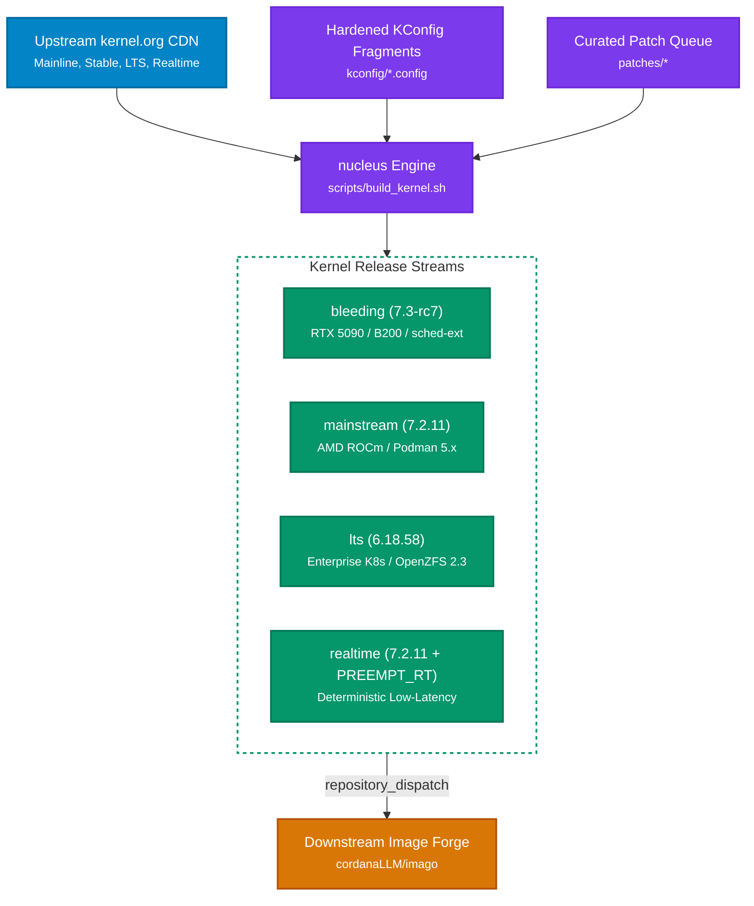

# Lusoris Kernel Forge

<!-- praetor:readme-governance:start -->
[![HISS Adopted][praetor-hiss-badge]][praetor-hiss-agents]
[![Documentation Governance][praetor-docs-badge]][praetor-docs-runs]

Praetor manages this repository's declared governance policy. This managed
block records adoption state; it is not a verification certificate.

**Verification**: `make verify-all` runs the repository's configured
verification cascade.

**HISS Audit**: `praetorctl audit` enforces policy, generated-surface
integrity, and the debt ratchet.

**Context Sync**: `praetorctl compile-context --verify` verifies every
generated agent context against `AGENTS.md`.

**Documentation**: `make docs-lint` enforces locked Markdown style and the
private scratch-link policy.

**Debt Baseline**: `.standards-baseline.json` anchors the debt ratchet at
0 recorded infractions; audit forbids growth.

[praetor-hiss-badge]: https://img.shields.io/badge/Standards-HISS%20Adopted-blue
[praetor-hiss-agents]: https://github.com/cordanaLLM/nucleus/blob/HEAD/AGENTS.md
[praetor-docs-badge]: https://github.com/cordanaLLM/nucleus/actions/workflows/praetor-docs.yml/badge.svg
[praetor-docs-runs]: https://github.com/cordanaLLM/nucleus/actions/workflows/praetor-docs.yml
<!-- praetor:readme-governance:end -->

[](LICENSE)
[](.github/workflows/ci.yml)
[](https://github.com/cordanaLLM/imago)
[](https://www.bestpractices.dev/projects/15665)

`cordanaLLM/nucleus` is the companion repository and automated build forge producing customized, hardened, and hardware-optimized Linux kernel distributions for `imago`.

---

## 1. Mission & Architecture

`cordanaLLM/nucleus` decouples low-level kernel compilation from cloud image creation:

1. **Multi-Stream Channels**: Builds and packages 4 kernel streams from live upstream sources (kernel.org).
2. **Multi-Architecture**: Produces native `.deb` packages for `x86_64` (AMD64), `arm64` (AArch64), and `riscv64`.
3. **Hardened Configuration Fragments**: Enforces NASA/JPL Power of 10 principles, KSPP security hardening, BBR congestion control (BBRv1 the default; BBRv3 as a module on `bleeding`, `mainstream` and `realtime`, from Google's patch series in [`docs/patches.md`](docs/patches.md)), eBPF sched-ext scheduling, and NVMe-oF TCP optimizations. Every release in OpenZFS's supported Linux range is checked by building the OpenZFS module against its published headers (section 5.6 of [`docs/packaging.md`](docs/packaging.md)).
4. **Bidirectional Downstream Integration**: Synchronizes verified releases downstream to `imago` via GitHub `repository_dispatch`. A kernel release is tagged `v<version>-<stream>-lusoris<N>`; the repository's own releases are tagged `nucleus-v<X.Y.Z>` and never start one (section 5.4 of [`docs/packaging.md`](docs/packaging.md)).



---

## 2. Kernel Streams Matrix

| Stream | Upstream Base | Target Workloads & Hardware Stack | Default In Flavors |
| :--- | :--- | :--- | :--- |
| **`bleeding`** | **Linux 7.3-rc7** | NVIDIA Blackwell RTX 5090 / B200 (open kernel modules checked in CI, [packaging 5.7](docs/packaging.md#57-nvidia-open-gpu-kernel-modules-build-githubworkflowsnvidia-open-moduleyml)), CXL 3.0, sched-ext, BBR | `*-nvidia-bleeding` |
| **`mainstream`** | **Linux 7.2.11** | Podman 5.x; Intel Arc Battlemage Xe2 (`xe`) and AMD Radeon for ROCm (`amdgpu` with KFD) are built and claimed on all four streams on x86_64 (arm64 waits for a consumer requirement document); NVIDIA open kernel modules checked in CI ([packaging 5.7](docs/packaging.md#57-nvidia-open-gpu-kernel-modules-build-githubworkflowsnvidia-open-moduleyml)) | `base-*`, `docker-*`, `ai-infer-*` |
| **`lts`** | **Linux 6.18.58** | Enterprise Kubernetes nodes (`k8s-node-*`), OpenZFS 2.3, CloudNativePG (`cloudnative-pg`) | `k8s-node-*`, `cloudnative-storage` |
| **`realtime`** | **Linux 7.2.11**, in-tree `PREEMPT_RT` | PREEMPT_RT deterministic gaming servers, low-latency audio/telecom, WireGuard gateway | `appliance-game-server`, `appliance-gateway-dns` |

Intel Arc Battlemage (Xe2) on `xe` and AMD Radeon for ROCm on `amdgpu` with `HSA_AMD` are built and claimed across all four streams on x86_64; arm64 is not claimed until a consumer requirement document asks for it. Level Zero is user space: `intel/compute-runtime` runs on the xe uAPI and needs no kernel patch; nucleus ships no user space. The oldest pinned stream (`lts` 6.18.58) provides the xe uAPI of Linux 6.18 (`include/uapi/drm/xe_drm.h`).

### Downstream Kernel Requirements

Consumers publish what they need from a kernel as an `aegis.p01-nucleus.kernel-requirement.v1` document, and `versions.json` `downstream.requirements` binds each one to the streams it consumes:

| Consumer | Document | Bound streams |
| :--- | :--- | :--- |
| `imago` | `cordanaLLM/imago` `kernel/requirement.json` | `bleeding`, `mainstream`, `lts`, `realtime` |
| `aegis-os` | `cordanaLLM/Aegis-OS` `build/kernel-requirement.json` | `realtime` |

`verify-requirements.yml` reads each document at a pinned commit and fails when a bound stream does not declare every required symbol in its exact state. To check the copies under `tests/fixtures/`:

```bash
python3 scripts/verify_kernel_requirement.py \
  --requirement imago=tests/fixtures/kernel-requirement/imago.json \
  --requirement aegis-os=tests/fixtures/kernel-requirement/aegis-os.json
```

Each fetched document is also read through the JSON Schema Aegis-OS publishes for it, pinned by commit and sha256 in `versions.json` `downstream.requirement_schema`, before the verifier decides; the two readings must agree ([ADR-0010](docs/adr/0010-owner-json-schema-for-requirement-documents.md)). To check the copies under `tests/fixtures/` against the pinned schema:

```bash
python3 scripts/check_requirement_schema.py check \
  --requirement imago=tests/fixtures/kernel-requirement/imago.json \
  --requirement aegis-os=tests/fixtures/kernel-requirement/aegis-os.json
```

The policy is [ADR-0007](docs/adr/0007-document-driven-kernel-requirements.md); the stream fragments, bindings and the schema pin are in [docs/streams.md](docs/streams.md).

---

## 3. Quickstart & Local Building

### Install a release

Download published release packages with `gh release download <release-tag> -R cordanaLLM/nucleus` (or from GitHub Releases), verify the signature bundle and checksums, then install the kernel and header packages:

```bash
cosign verify-blob --bundle SHA256SUMS.bundle --certificate-identity "https://github.com/cordanaLLM/nucleus/.github/workflows/release-build.yml@refs/tags/<release-tag>" --certificate-oidc-issuer https://token.actions.githubusercontent.com SHA256SUMS
sha256sum -c SHA256SUMS
sudo dpkg -i linux-image-*.deb linux-headers-*.deb
```

For full artifact details, verification semantics, and current operational limits, see [Verify and Install a Release](docs/install.md).

### Prerequisites

- An Ubuntu 26.04 host or container with the kernel build toolchain; the build workflows install
  it with the same script:

  ```bash
  sudo ./scripts/install-build-toolchain.sh             # add --with-qemu for the boot smoke test
  ```

- The Python test and documentation dependencies on Python 3.12 or later (CI runs the suite on
  3.12 and on 3.14, the build container's `python3`), from the hash-pinned lock file
  ([CONTRIBUTING.md](CONTRIBUTING.md) says how it is compiled):

  ```bash
  pip install --require-hashes -r requirements-test.txt
  ```

### Build & Packaging Recipes

```bash
# Display all ergonomic developer targets
make help

# Merge the security baseline, architecture and stream fragments (STREAM defaults to mainstream)
make merge-config ARCH=x86_64 STREAM=realtime

# Fetch a stream's kernel source and prove it (pinned sha256 and kernel.org signature, or the
# signed release-candidate tag), then resolve the configuration against it and check that every
# requested value survived make olddefconfig; needs gpgv, gpg, pahole and the cross compilers
make fetch-source STREAM=realtime
make resolve-config STREAM=realtime ARCH=arm64

# Compile a stream into Debian packages: fetch, resolve, bindeb-pkg, then the artifact gate opens
# every package before anything is checksummed. Writes output/<stream>-<arch>/ (packages,
# vmlinuz-<kernelrelease>, kernel-<stream>-<arch>.config), which must be empty or absent, so run
# one of the two commands below, not both; DRY_RUN=true only states the plan
make build-kernel STREAM=mainstream ARCH=x86_64 DRY_RUN=false
# ...or the same build from a tree scripts/fetch-kernel-source.sh already verified
make package-deb STREAM=mainstream ARCH=x86_64 DRY_RUN=false SOURCE_TREE=build/linux-mainstream

# Boot a built x86_64 kernel to userspace under QEMU
make boot-smoke KERNEL=output/mainstream-x86_64/vmlinuz-7.2.10-lusoris1-mainstream \
  KERNELRELEASE=7.2.10-lusoris1-mainstream

# Simulate Unified Kernel Image (UKI) synthesis: DRY_RUN=true is the Makefile default. It writes a
# marked text file under output/<stream>-<arch>-dry-run/, never a .efi.
# A real UKI needs a built kernel and ukify (DRY_RUN=false VMLINUZ=<path>); see docs/packaging.md, section 3.
make package-uki STREAM=mainstream ARCH=x86_64

# Compare two build output directories byte for byte (DRY_RUN=true, the default, only states it).
# Two builds with one --module-key are byte-identical, a CI gate; see docs/packaging.md, section 2.1
make verify-reproducibility DRY_RUN=false DIR_A=<dir> DIR_B=<dir>

# Run the hermetic tests of the boot smoke test
make test-boot

# Build the local build container (the CI image and toolchain)
make docker-builder
```

Output `.deb` packages, the kernel image and the resolved configuration are staged under
`output/<stream>-<arch>/`; the build record and log stay in `build/<stream>-<arch>/`
([`docs/packaging.md`](docs/packaging.md), section 2).

### Governance Recipes

The repository is governed by praetor, pinned as `PRAETOR_REF` in `.github/workflows/ci.yml`
([Repository Governance](docs/repository-governance.md)):

```bash
# Recompile CLAUDE.md and the other agent context files after editing AGENTS.md
make context

# Re-render the branch ruleset after changing a pull-request workflow job
make ruleset

# Run the praetor checks the CI job runs
make governance-check PRAETOR_SRC=<praetor checkout at the pin>
```

---

## 4. Repository Structure

```text
.
├── .config/archetypes/         # praetor policy catalog, pinned by .standards.lock
├── .github/rulesets/main.json  # Branch ruleset rendered by `make ruleset`
├── .github/workflows/          # Automated build & downstream synchronization workflows
├── .standards.yaml             # praetor manifest: profile, facets, review mode
├── AGENTS.md                   # Authoritative AI agent directives; source of CLAUDE.md and the other agent files
├── docs/                       # Architecture, onboarding, and stream documentation
│   ├── onboarding.md           # Step-by-step onboarding guide for agents & contributors
│   ├── principles.md           # Engineering principles & NASA/JPL Power of 10 adaptations
│   ├── streams.md              # Detailed stream specifications
│   └── patches.md              # Patch queue management & upstreaming policy
├── keys/                       # kernel.org signing keys the source verification trusts
├── kconfig/                    # Modular kernel configuration fragments
│   ├── x86_64.config           # AMD64 virtualization & bare-metal baseline
│   ├── arm64.config            # AArch64 Neoverse & Apple Silicon baseline
│   ├── riscv64.config          # RISC-V 64-bit baseline
│   ├── streams/bleeding.config # Bleeding stream layer (legacy xtables raw table)
│   ├── streams/mainstream.config # Mainstream stream layer (legacy xtables raw table)
│   ├── streams/lts.config      # LTS stream layer (legacy xtables raw table)
│   ├── streams/realtime.config # PREEMPT_RT stream layer
│   └── security-hardened.config# Kernel Self-Protection Project (KSPP) baseline
├── patches/                    # Curated patch queues partitioned by stream (none carried)
├── scripts/                    # Verified build and notification automation
├── tests/                      # Automated pytest and static analysis suite
└── versions.json               # Declarative Single Source of Truth
```

---

## 5. Security & Privacy Invariants

- **Zero-Leak Invariant**: No RFC 1918 private IPs (`10.x`, `192.168.x`, `172.16-31.x`) or developer workstation paths (`/home/...`) are permitted in tracked files. Placeholders like `192.0.2.x` and `kernel.example.com` must be used.
- **Power of 10 Compliance**: All shell functions are constrained to $\le 60$ lines with `set -euo pipefail` and zero ShellCheck warnings.
- **Verified Sources**: Every kernel source is pinned in `versions.json` (a tarball `sha256`, or a tag and its commit) and used only after its kernel.org signature verifies against a key in `keys/` that the stream lists (`scripts/fetch-kernel-source.sh`, [ADR-0008](docs/adr/0008-signed-kernel-sources-and-resolved-configuration.md)).

---

## 6. License & Copyright

Copyright &copy; 2026 The Lusoris Authors.

From version 0.3.0 on, `cordanaLLM/nucleus` is licensed under the
[European Union Public Licence 1.2](LICENSE) (`EUPL-1.2`). Versions up to and including 0.2.x were
released under the Apache License 2.0 and keep that licence.

| What | Licence |
| :--- | :--- |
| Code, workflows, configuration, tests | `EUPL-1.2` |
| Documentation text (`README.md`, the root policy files, `docs/`) | `CC-BY-SA-4.0` |
| The Code of Conduct (`CODE_OF_CONDUCT.md`, `docs/community/code-of-conduct.md`), adapted from the Contributor Covenant 2.1 | `CC-BY-4.0` |
| Kernel patches under `patches/` (none carried) | `GPL-2.0-only`, the licence of the kernel they change |
| kernel.org signing keys under `keys/` | `CC0-1.0`; a public key is not a work under copyright |
| Test fixtures copied from other repositories | the licence of their source, named in `REUSE.toml` |
| The vendored figure engine interfig, `tools/figures/third_party/interfig/upstream/` (Vectorize AI, Inc.) | `MIT` |

The version above is the version of this repository (`VERSION`). The kernel release tags
(`v<kernel version>-<stream>-lusoris<N>`) count separately, and the kernel packages a release
carries stay under the kernel's `GPL-2.0-only`.

`REUSE.toml` states the licence and the copyright holder of every file, `LICENSES/` holds each
licence text, and the `REUSE lint` job (`.github/workflows/licence.yml`) checks both on every pull
request. Run the same check locally with `reuse lint`.
