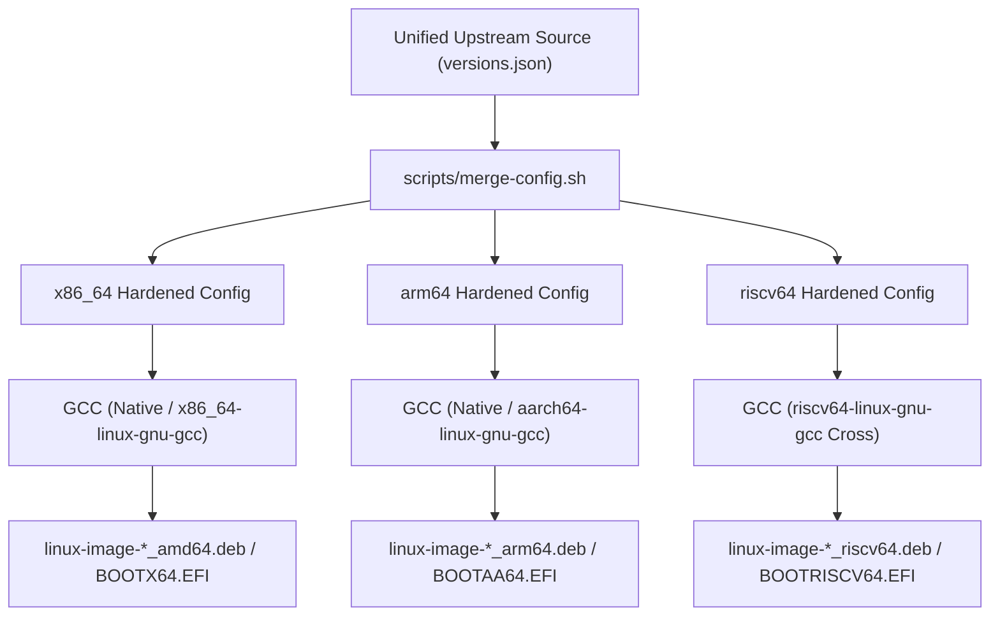

# Multi-Architecture Strategy & Compilation Matrix

> In-depth technical guide on cross-compiling, validating, and optimizing Linux kernels for `x86_64`, `arm64`, and `riscv64` targets.

---

## 1. Architectural Support Matrix

`cordanaLLM/nucleus` targets three primary ISA families, each optimized for specific virtualization, cloud-native, and bare-metal hardware platforms:

| Architecture | ISA Baseline | Target Microarchitectures | Boot Artifact | Page Size | Primary Virtualization |
| :--- | :--- | :--- | :--- | :--- | :--- |
| **`x86_64`** | `x86-64-v3` (AVX2, BMI2) | AMD Zen 3/4/5, Intel Sapphire Rapids / Emerald Rapids / Granite Rapids | `arch/x86/boot/bzImage` | 4 KB | KVM (Intel VMX / AMD SVM) |
| **`arm64`** | `armv8.2-a+crypto+fp16` | Ampere Altra/AmpereOne, AWS Graviton 3/4, Apple Silicon VMs | `arch/arm64/boot/Image.gz` | 4 KB / 64 KB | KVM (ARM GICv3 / GICv4) |
| **`riscv64`** | `rva22` / `rva23` (RV64GCVB) | SiFive P550/P670, StarFive JH7110, Tenstorrent Ascalon | `arch/riscv/boot/Image` | 4 KB | KVM (RISC-V AIA / PLIC) |



---

## 2. Toolchain Selection: GNU GCC

All kernels in `cordanaLLM/nucleus` are compiled using the GNU Compiler Collection (GCC) toolchain via the architecture-specific cross-compiler prefixes declared in `versions.json` (`scripts/install-build-toolchain.sh`, `versions.json`). Native `x86_64` builds use `x86_64-linux-gnu-gcc`, native `arm64` builds use `aarch64-linux-gnu-gcc`, and `riscv64` targets are cross-compiled using `riscv64-linux-gnu-gcc`. Build scripts invoke `make bindeb-pkg` with `CROSS_COMPILE` set to the declared triplet and do not pass `LLVM=1`.

---

## 3. Architecture-Specific Kernel Configurations

### 3.1 `x86_64` (AMD64)

- **Architecture Level**: Built with `CONFIG_GENERIC_CPU=y` with microarchitecture level `v3` baseline (`AVX2`, `BMI1`, `BMI2`, `FMA`).
- **Memory Management**: 5-level paging enabled (`CONFIG_X86_5LEVEL=y`) supporting up to 4 PB physical memory and 128 PB virtual address space.
- **Microcode Loader**: Early microcode updating (`CONFIG_MICROCODE=y`) built-in for early speculative execution mitigation (Spectre v2, Retbleed, Downfall, SRSO).
- **Virtualization Acceleration**: the host hypervisor `CONFIG_KVM=m` with both vendor backends, `CONFIG_KVM_INTEL=m` and `CONFIG_KVM_AMD=m` (imago `FLAVOR-BASE`, Aegis-OS `REQ-BOOT-01`), and device passthrough through `CONFIG_VFIO=m` and `CONFIG_VFIO_PCI=m` behind the Intel and AMD IOMMU drivers.
- **Requirement Prerequisites** (`kconfig/x86_64.config`): `CONFIG_IKCONFIG_PROC` for the `/proc/config.gz` probe; `CONFIG_DEBUG_KERNEL` and `CONFIG_DEBUG_INFO_DWARF5` so that `CONFIG_DEBUG_INFO_BTF` survives `olddefconfig` (the build host needs pahole 1.22 or newer); `CONFIG_BPF_LSM`; `CONFIG_POWERCAP` with `CONFIG_INTEL_RAPL=m`. The requirement documents and their bindings are in [Kernel Streams](../streams.md#5-consumer-bindings).

### 3.2 `arm64` (AArch64)

- **Architecture Level**: Enforces ARMv8.2-A with Crypto Extensions (`CONFIG_ARM64_CRYPTO=y`, AES/SHA2/SHA3 accelerated via NEON/SVE).
- **Pointer Authentication & BTI**:
  - `CONFIG_ARM64_PTR_AUTH=y`: In-kernel pointer authentication preventing return address hijacking.
  - `CONFIG_ARM64_BTI=y`: Branch Target Identification to enforce valid branch landing pads.
- **Page Size Policy**:
  - Standard clouds (Proxmox, KVM, Docker): 4 KB page size (`CONFIG_ARM64_4K_PAGES=y`) for compatibility with commercial container images.
  - High-Performance Database / HPC: Optional 64 KB page configuration (`CONFIG_ARM64_64K_PAGES=y`) to minimize TLB miss penalties on multi-terabyte memory nodes.
- **ACPI & DeviceTree Dual Boot**: Supports both ACPI enterprise boot (Neoverse servers, Ampere Altra) and Flattened Device Tree (FDT) for edge boards.
- **BTF for sched-ext**: `CONFIG_SCHED_CLASS_EXT` depends on `CONFIG_DEBUG_INFO_BTF`, so `kconfig/arm64.config` declares its chain: `CONFIG_DEBUG_KERNEL`, `CONFIG_DEBUG_INFO_DWARF5`, and `# CONFIG_DEBUG_INFO_REDUCED is not set`, which the arm64 defconfig would otherwise set.
- **BPF trampolines**: the arm64 defconfig unsets `CONFIG_FTRACE`; the security baseline sets it with `CONFIG_FUNCTION_TRACER`, `CONFIG_DYNAMIC_FTRACE` and `CONFIG_DYNAMIC_FTRACE_WITH_DIRECT_CALLS`. Direct calls need GCC's `-fpatchable-function-entry` (`DYNAMIC_FTRACE_WITH_ARGS`) and, before Linux 7.3, `DYNAMIC_FTRACE_WITH_CALL_OPS`, which a `CFI` or size-optimized build loses ([ADR-0011](../adr/0011-bpf-trampoline-ftrace-and-release-revisions.md)).

### 3.3 `riscv64` (RISC-V 64-bit)

- **Profile Alignment**: RVA22 / RVA23 profiles with standard extensions: `rv64imafdc_zicsr_zifencei_zba_zbb_zbs_zicboz_zicbom`.
- **Vector Extension**: `CONFIG_RISCV_ISA_V=y` enabling hardware vector computing (RVV 1.0) for in-kernel cryptographic hashing and user-space AI workloads.
- **Advanced Interrupt Architecture (AIA)**:
  - `CONFIG_RISCV_AIA=y`: Native message-signaled interrupts (IMSIC) and incoming interrupt controller (APLIC) replacing legacy PLIC bottlenecks.
- **SBI (Supervisor Binary Interface)**: Compliant with RISC-V SBI v2.0+ specification for system reset, timer, and IPI handling.
- **KASLR**: `CONFIG_RANDOMIZE_BASE` (the security baseline) depends on `CONFIG_RELOCATABLE` on riscv since Linux 7.2, and the riscv defconfig leaves it unset, so `kconfig/riscv64.config` declares it.
- **BPF trampolines**: `CONFIG_DYNAMIC_FTRACE_WITH_DIRECT_CALLS` (the security baseline) needs `DYNAMIC_FTRACE_WITH_CALL_OPS` on riscv, which a `CFI` build loses, and `HAVE_DYNAMIC_FTRACE` needs GCC's `-fpatchable-function-entry=8` and, with compressed instructions (`RISCV_ISA_C`), `-fmin-function-alignment` ([ADR-0011](../adr/0011-bpf-trampoline-ftrace-and-release-revisions.md)).
- **BTF for CO-RE eBPF**: `kconfig/riscv64.config` declares `CONFIG_DEBUG_KERNEL`, `CONFIG_DEBUG_INFO_DWARF5` and `CONFIG_DEBUG_INFO_BTF` so that BTF debug metadata is built into vmlinux (the build host needs pahole 1.22 or newer).
- **sched-ext Dynamic Schedulers**: `kconfig/riscv64.config` declares `CONFIG_SCHED_CLASS_EXT=y` to enable BPF-extensible scheduler class policies; its dependency on `CONFIG_DEBUG_INFO_BTF` is met by the BTF chain declared beside it.

---

## 4. Hermetic Cross-Compilation Pipeline

`docker/Dockerfile.builder` is the CI build environment as a local container: it starts from the `ubuntu:26.04` image `build-matrix.yml` pins by digest and installs the toolchain with the same `scripts/install-build-toolchain.sh --with-qemu`, so a local build uses the compilers the matrix uses:

```bash
# Build multi-architecture builder container
make docker-builder
# Or manually:
docker build -t lusoris-kernel-builder -f docker/Dockerfile.builder .
```

The container provides GCC with the cross-compilers (`gcc-aarch64-linux-gnu`, `gcc-riscv64-linux-gnu`), `pahole`, GNU `install` (`gnuinstall`), `ccache`, `gpgv` and `qemu-system-x86_64`, and nothing the matrix does not install; it carries no LLVM, `ukify`, `dracut` or `diffoscope`. `tests/test_builder_image.py` refuses a Dockerfile that drifts from the pinned image or installs packages of its own, and the `Builder Image` job in `build-matrix.yml` builds the container, checks those tools inside it and states a build plan there.

Kernel compilation for target architectures is orchestrated using `make build-kernel` or directly via `scripts/build_kernel.sh`:

```bash
# State the compilation plan without compiling:
make build-kernel STREAM=mainstream ARCH=arm64 DRY_RUN=true

# Compile kernel and generate Debian packages (DRY_RUN defaults to true):
make build-kernel STREAM=mainstream ARCH=arm64 DRY_RUN=false
```

Or directly via the build script:

```bash
./scripts/build_kernel.sh --stream=mainstream --arch=arm64 --dry-run
./scripts/build_kernel.sh --stream=mainstream --arch=arm64
```

---

## 5. MicroVM Boot Verification Matrix

Automated microVM boot testing under QEMU is implemented across all supported architectures (`scripts/boot_smoke.py`). In CI (`.github/workflows/build-matrix.yml`), builds for `x86_64`, `arm64`, and `riscv64` boot a static init in QEMU (TCG) and require the kernel banner and init marker within the timeout. For `arm64` and `riscv64`, the workflow also proves that a nonexistent console device refuses the boot when the console stays silent.

```bash
# Automated boot smoke test across architectures (scripts/boot_smoke.py)
python3 scripts/boot_smoke.py \
  --arch=<arch> \
  --kernel=output/<stream>-<arch>/vmlinuz-<kernelrelease> \
  --kernelrelease=<kernelrelease>
```

The smoke test verifies:

1. Detection of `Linux version <kernelrelease>` from the serial console.
2. The static `/init` printed its `NUCLEUS-BOOT-SMOKE release=<kernelrelease>` line.
3. QEMU exited before the timeout: the init powers the machine off with `reboot(LINUX_REBOOT_CMD_POWER_OFF)`, and a run killed at the timeout fails.
