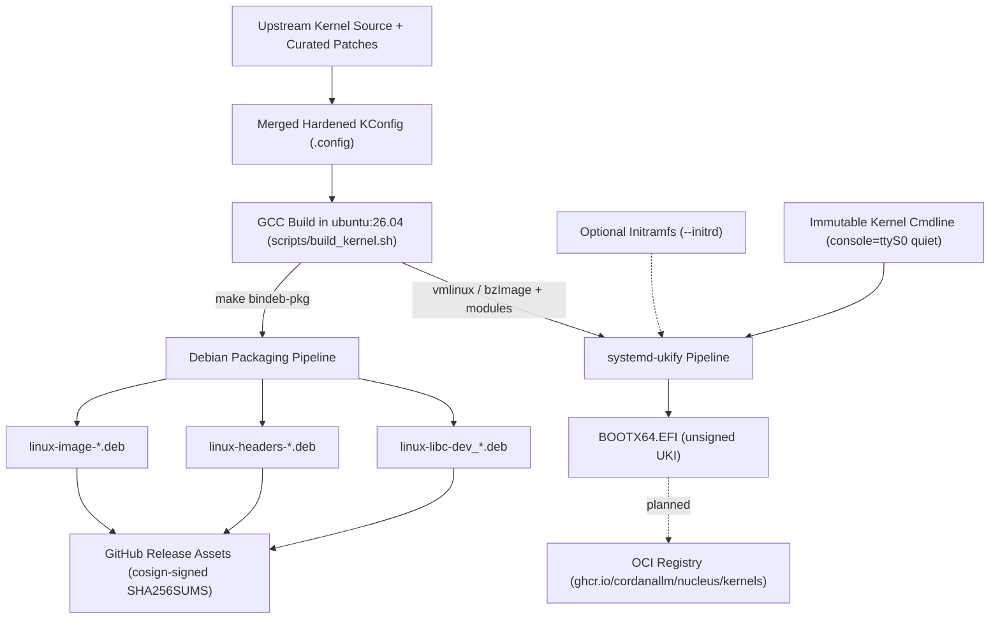

# Kernel Packaging & Delivery Architecture

> Authoritative engineering guide covering Debian `bindeb-pkg` compilation, systemd-ukify Unified Kernel Image (UKI) synthesis, initramfs contracts, and OCI distribution.

---

## 1. Overview & Dual Packaging Strategy

`cordanaLLM/nucleus` delivers compiled kernels through two complementary delivery formats:

1. **Standard Debian Packages (`.deb`)**, named `<package>_<version>-lusoris<N>_<debian arch>.deb`
   (section 2.2):
   - `linux-image-<kernelrelease>`: the compressed kernel (`/boot/vmlinuz-<kernelrelease>`), its
     configuration (`/boot/config-<kernelrelease>`), `System.map`, the stripped modules
     (`/lib/modules/<kernelrelease>`) and, on arm64 and riscv64, the device trees.
   - `linux-headers-<kernelrelease>`: headers and host programs for out-of-tree modules (DKMS).
     Built on x86_64 and arm64, not on the cross-compiled riscv64 (section 2.3).
   - `linux-libc-dev`: the kernel's user-space API headers.
   - Designed for standard Debian/Ubuntu OS installations, container base hosts, and golden image provisioning in `cordanaLLM/imago`.

2. **Unified Kernel Images (UKI, `.efi`)**:
   - Single, self-contained, unsigned UEFI PE binary combining the systemd-stub, the Linux kernel (`.linux`), the kernel command line (`.cmdline`), and OS release, kernel release and SBAT metadata (`.osrel`, `.uname`, `.sbat`). An initramfs (`.initrd`) is embedded only when one is passed; no CPU microcode is embedded (section 3.1).
   - Designed for UEFI boot and direct network streaming (iPXE / systemd-boot). Secure Boot signing and TPM 2.0 PCR 11 pre-calculation are planned and not wired yet (sections 3.2 and 3.4).



---

## 2. Native Debian Packaging (`bindeb-pkg`)

`scripts/build_kernel.sh` compiles one stream for one architecture into Debian packages with the
kernel's own `bindeb-pkg` target ([ADR-0009](adr/0009-kernel-compilation-and-artifact-gate.md)).
It starts from two inputs, both produced before anything compiles
([ADR-0008](adr/0008-signed-kernel-sources-and-resolved-configuration.md)):

1. **A verified source tree**: `scripts/fetch-kernel-source.sh --stream=<stream> --dest=<dir>`
   checks the pinned `sha256` and the kernel.org signature of a tarball, or `git verify-tag` and
   the pinned commit of a release-candidate tag, and refuses otherwise. `build_kernel.sh` runs it
   unless `--source-tree` names a tree it already verified.
2. **A resolved configuration**: `scripts/merge-config.sh --stream=<stream> --arch=<arch>
   --source-tree=<dir>` applies the architecture defconfig, the fragments and `make
   olddefconfig`, refuses when a requested value did not survive, and writes
   `kernel-<stream>-<arch>.config`. Its build directory is the `O=` directory of the compile.

```bash
# A verified tree, then one leg; the output directory must be empty or absent
./scripts/fetch-kernel-source.sh --stream=mainstream --dest=build/linux-mainstream
./scripts/build_kernel.sh --stream=mainstream --arch=x86_64 --source-tree=build/linux-mainstream
make build-kernel STREAM=mainstream ARCH=x86_64 DRY_RUN=false SOURCE_TREE=build/linux-mainstream

# State what a build would do, without fetching, compiling or writing anything
./scripts/build_kernel.sh --stream=bleeding --arch=riscv64 --dry-run
```

The result is `output/<stream>-<arch>/` holding exactly the packages, `vmlinuz-<kernelrelease>`
(extracted from the image package) and `kernel-<stream>-<arch>.config`, and a build record
`build/<stream>-<arch>/build.json` with the kernelrelease, the package version, the profiles, the
build time and the configuration's digest. The compiler's output goes to
`build/<stream>-<arch>/build.log`; on failure its last 60 lines are printed. Options:
`--work-dir` (default `build`), `--output-dir` (default `output/<stream>-<arch>`), `--revision`
(default 1, section 2.2) and `--jobs` (default `nproc`).

### 2.1 Invocation & Environment Controls

The compile is this, with the values `versions.json` gives for the stream and architecture:

```bash
DEB_BUILD_PROFILES="pkg.linux-upstream.nokerneldbg" \
make -C build/linux-mainstream O=build/mainstream-x86_64/kbuild \
  ARCH=x86_64 CROSS_COMPILE=x86_64-linux-gnu- \
  LOCALVERSION=-lusoris1-mainstream KDEB_PKGVERSION=7.2.10-lusoris1 \
  -j"$(nproc)" bindeb-pkg
```

The kernel image carries no clock and no builder identity:

| Variable | Value | Why |
| :--- | :--- | :--- |
| `SOURCE_DATE_EPOCH` | the modification time of the tree's `Makefile` | `git archive`, which makes kernel.org's tarballs and the git-tag export alike, stamps every file with the release commit's time |
| `KBUILD_BUILD_TIMESTAMP` | that time as a `date` string, for example `Fri Sep 25 14:37:14 UTC 2026` | the timestamp in `uname -v` |
| `KBUILD_BUILD_USER`, `KBUILD_BUILD_HOST` | `nucleus`, `forge` | the `(nucleus@forge)` in the boot banner |
| `LC_ALL`, `TZ` | `C`, `UTC` | locale- and zone-independent tool output |

`CROSS_COMPILE` is set on every host, the native one included, so the configuration records the
same compiler wherever it is built: Ubuntu 26.04's native and cross compilers both report
`(Ubuntu 15.2.0-16ubuntu1) 15.2.0`. The kernel's `debian/rules` sets `KBUILD_BUILD_VERSION` to the
package revision, so `uname -v` reads `#lusoris1 SMP PREEMPT_DYNAMIC Fri Sep 25 14:37:14 UTC 2026`.

The build installs files with GNU `install`. Ubuntu 26.04's `/usr/bin/install` is uutils coreutils,
whose `install -D` fails when parallel calls create the same directory, as the device-tree install
of every arm64 and riscv64 build does. Ubuntu keeps GNU `install` as `gnuinstall`
(`gnu-coreutils`), so when `install` is not GNU, `build_kernel.sh` links
`build/<stream>-<arch>/gnu-install/install` to `gnuinstall` and puts that directory first on the
build's `PATH`; with neither, it refuses. Replacing uutils altogether is not an option there:
`build-essential` depends on it, and `bindeb-pkg` checks the build dependencies.

The packages are not yet shown to be bit-for-bit reproducible. Both known causes are handled:

- The modules are signed after the build, not during it
  ([ADR-0016](adr/0016-module-signing-after-the-build.md)). The build generates no key:
  `kconfig/security-hardened.config` turns `CONFIG_MODULE_SIG_ALL` off, sets
  `CONFIG_MODULE_SIG_KEY=""`, and makes the kernel trust `certs/nucleus-module-signing.pem` in the
  build directory (`CONFIG_SYSTEM_TRUSTED_KEYS`). `build_kernel.sh` writes that certificate from
  the key that `--module-key=<pem>` names, or from a key it generates for this build with the
  kernel's `certs/default_x509.genkey` and deletes after signing. After `bindeb-pkg`,
  `scripts/sign_kernel_modules.py` signs every module of the image package with the build's
  `sign-file` (in the build directory's `scripts/`), verifies each signature against the certificate, rewrites
  `DEBIAN/md5sums` and rebuilds the package; the unsigned package stays in
  `<work-dir>/<stream>-<arch>/unsigned/` and `build.json` records the step under
  `module_signing`. The artifact gate refuses a module without a signature. Two builds sign alike
  only with one key: without `--module-key` each build has its own, so their image packages and
  `vmlinuz` still differ by the key, and their unsigned packages are what compares.
- The kernel's `scripts/package/mkdebian` dates `debian/changelog` with `$(date -R)`, which would
  ordinarily stamp the wall clock into `usr/share/doc/<package>/changelog.Debian.gz`. `build_kernel.sh`
  eliminates this variance by prepending a `date` wrapper (`scripts/lib/date-from-epoch.sh`) to `PATH`
  only for the `bindeb-pkg` make call. When invoked with exactly `-R`, the wrapper formats
  `SOURCE_DATE_EPOCH` in UTC (`date -u -R -d "@${SOURCE_DATE_EPOCH}"`), while passing any other
  invocations through unchanged to the real `date` binary. The changelog's maintainer line is
  `nucleus <nucleus@forge>`: `build_kernel.sh` sets `KBUILD_BUILD_USER` and `KBUILD_BUILD_HOST` and
  unsets `DEBFULLNAME` and `DEBEMAIL`, which `mkdebian` would otherwise prefer.

The `Reproducible Build (mainstream / x86_64)` job in `.github/workflows/build-matrix.yml` is the
gate for issue #77: it builds `mainstream`/x86_64 twice in one job, each time from a fresh tree under
the same work directory, without the compiler cache, and with one `--module-key` it generates and
deletes afterwards, then fails unless `scripts/verify-reproducibility.sh` (section 3) finds the two
output directories byte-identical. It runs on every pull request that touches the build path, on
the weekly schedule and on dispatch. A stable release signing key is the operator's to create and
is not configured.

### 2.2 Localversion & Package Naming Contract

| | Form | `mainstream` |
| :--- | :--- | :--- |
| `LOCALVERSION` | `-lusoris<N>-<stream>` | `-lusoris1-mainstream` |
| kernelrelease (`uname -r`) | `<kernelversion>-lusoris<N>-<stream>` | `7.2.10-lusoris1-mainstream` |
| package version (`KDEB_PKGVERSION`) | `<debian_version>-lusoris<N>` | `7.2.10-lusoris1` |
| image package file | `linux-image-<kernelrelease>_<package version>_<debian arch>.deb`, `~` spelled `.` | `linux-image-7.2.10-lusoris1-mainstream_7.2.10-lusoris1_amd64.deb` |

`<debian_version>` is the stream's version with a release candidate's `-rc<N>` spelled `~rc<N>`
(`scripts/versions_query.py source <stream>`, field `debian_version`), the spelling the kernel's
own `mkdebian` uses. dpkg sorts `~` before anything, so `7.3~rc7-lusoris1` is older than the final
`7.3-lusoris1`, while `7.3-rc7-lusoris1` would be newer and would never be upgraded; that matters
most for `linux-libc-dev`, which has one package name for every release:

```bash
dpkg --compare-versions 7.3~rc7-lusoris1 lt 7.3-lusoris1 && echo older   # older
dpkg --compare-versions 7.3-rc7-lusoris1 lt 7.3-lusoris1 || echo newer   # newer
```

The file names spell that `~` as `.`: GitHub renames `~` in a release asset to `.`, and imago's
artifact name pattern refuses `~`, so `SHA256SUMS` and the manifest name the files as they are
served. The `bleeding` packages are therefore `linux-libc-dev_7.3.rc7-lusoris1_amd64.deb` and so on,
with `Version: 7.3~rc7-lusoris1` inside. The release tag (`v7.3-rc7-bleeding-lusoris1`), the
manifest's `version` (`7.3-rc7-lusoris1`) and the kernelrelease (`7.3.0-rc7-lusoris1-bleeding`)
keep `-rc7`.

The other streams are `7.3.0-rc7-lusoris1-bleeding` (package version `7.3~rc7-lusoris1`),
`6.18.56-lusoris1-lts` and `7.2.10-lusoris1-realtime`. The Debian architecture comes from
`architectures.<arch>.debian_arch` in `versions.json` (`amd64`, `arm64`, `riscv64`). `<N>` is the
forge revision, `--revision`; the release workflow passes the one its tag names (section 5.4).

The localversion keeps these packages from colliding with distribution kernels
(`linux-image-generic`, `linux-image-amd64`), and it is what tells `mainstream` and `realtime`
apart: both are built from the same 7.2.10 tree, whose `make kernelrelease` is `7.2.10` for either
without one.

### 2.3 Debug Symbols, Headers and Cross Builds

- The debug-symbol package is not built: every build uses the `pkg.linux-upstream.nokerneldbg`
  profile. The kernel keeps its DWARF-derived BTF (`CONFIG_DEBUG_INFO_BTF`), which eBPF needs,
  and the modules are installed stripped (`INSTALL_MOD_STRIP=1`, set by the kernel's
  `scripts/package/builddeb`).
- A build whose host architecture differs from its target adds
  `pkg.linux-upstream.nokernelheaders` and ships no headers package. The headers package rebuilds
  its host programs with the target compiler, `sign-file` among them, which links the target's
  `libcrypto`; a cross build has none. In `build-matrix.yml`, x86_64 and arm64 build natively
  (arm64 on the hosted `ubuntu-24.04-arm` runner) and riscv64 cross-compiles.

In `build-matrix.yml` on the 4-vCPU hosted runners, with a cold compiler cache, an x86_64 compile
took 1029 to 1208 s, a riscv64 compile 1023 to 1572 s and a native arm64 compile 2087 to 2250 s
(runs 36504114874 and 36507112520); a whole leg took 18 to 22 minutes on x86_64, boot included,
and up to 40 minutes on arm64. With the cache the x86_64 and riscv64 compiles took 47 to 114 s.

Measured sizes of the local builds (2026-09-29, `docker` `ubuntu:26.04` on an x86_64 host, 32
threads, so arm64 and riscv64 were cross-compiled there and have no headers package; riscv64
was then built without debug information and BTF, which it now carries, so its packages are
larger than measured here); imago accepts up to 512 MiB per artifact,
and `scripts/check_kernel_artifacts.py` refuses a larger artifact before checksumming
(`test_an_artifact_above_the_imago_bound_is_refused`):

| Leg | image package | headers | libc-dev | `vmlinuz` | object tree | compile |
| :--- | ---: | ---: | ---: | ---: | ---: | ---: |
| bleeding, x86_64 | 21.1 MB | 11.0 MB | 1.6 MB | 19.0 MB | 5.9 GiB | 210 s |
| mainstream, x86_64 | 20.9 MB | 10.9 MB | 1.6 MB | 18.8 MB | 5.9 GiB | 181 s |
| lts, x86_64 | 20.0 MB | 10.5 MB | 1.5 MB | 18.0 MB | 5.5 GiB | 159 s |
| realtime, x86_64 | 18.8 MB | 10.9 MB | 1.6 MB | 16.9 MB | 5.1 GiB | 211 s |
| mainstream, arm64 | 43.7 MB | none | 1.5 MB | 17.5 MB | 11 GiB | 522 s |
| mainstream, riscv64 | 16.8 MB | none | 1.5 MB | 11.0 MB | 1.1 GiB | 326 s |

### 2.4 The Artifact Gate

Nothing is checksummed before `scripts/check_kernel_artifacts.py` has opened it. It runs at the end
of every build and again in `publish-release.yml` before the SBOMs, `SHA256SUMS` and the
signature, and refuses the directory unless:

- it holds only non-empty regular files of at most 512 MiB: packages, `vmlinuz-<kernelrelease>` and
  `kernel-<stream>-<arch>.config`;
- `dpkg-deb -f` reads every package as `linux-image-<kernelrelease>`,
  `linux-headers-<kernelrelease>` or `linux-libc-dev`, at `<debian_version>-lusoris<N>` and the
  architecture's `debian_arch`, under the file name `<Package>_<Version>_<Architecture>.deb` with
  `~` spelled `.`, and no package appears twice;
- the image and `linux-libc-dev` packages are present, and so is the headers package, unless
  `--cross` says the build ran on another architecture (section 2.3); `build_kernel.sh` passes
  `--cross` for a cross build, and `publish-release.yml`, which builds natively, never does;
- the kernelrelease starts with the stream's kernel version and ends with `-lusoris<N>-<stream>`;
- the image package carries `./boot/vmlinuz-<kernelrelease>`, byte-identical to the
  `vmlinuz-<kernelrelease>` beside it, and `./boot/config-<kernelrelease>`, byte-identical to
  `kernel-<stream>-<arch>.config`, and `dpkg-deb` exits 0 after streaming the archive;
- the kernel image is a kernel of that release for the architecture:

  | Architecture | What the gate reads |
  | :--- | :--- |
  | x86_64 | a bzImage: `HdrS` at 0x202, and the version string the setup header points at (0x200 plus the 16-bit value at 0x20E) starts with `<kernelrelease>` and a space (`Documentation/arch/x86/boot.rst`) |
  | arm64 | `Image.gz`: one complete gzip stream of at most 256 MiB; the decompressed header has `ARM\x64` at 0x38, and the body the banner `Linux version <kernelrelease>` followed by a space |
  | riscv64 | the same, with `RSC\x05` at 0x38 |

  Any other kernel architecture, and another image format (`CONFIG_EFI_ZBOOT`, another
  compression), is refused until the gate learns it. The check says what the file is, not that
  it runs; section 2.5 boots it.

```bash
python3 scripts/check_kernel_artifacts.py --dir=output/mainstream-x86_64 --stream=mainstream \
  --arch=x86_64 --kernelrelease=7.2.10-lusoris1-mainstream
# A cross build (arm64 or riscv64 compiled on x86_64) makes no headers package:
python3 scripts/check_kernel_artifacts.py --dir=output/mainstream-riscv64 --stream=mainstream \
  --arch=riscv64 --kernelrelease=7.2.10-lusoris1-mainstream --cross
```

Exit status 0 passes, 1 refuses and lists every finding, 2 means the request cannot be evaluated
(an unknown stream or architecture, or no `dpkg-deb`).

### 2.5 Boot Smoke Test

Every built kernel is booted to userspace before it is kept: each leg of the matrix
after its build, and the release kernel in `publish-release.yml`'s build container, before
anything is checksummed or signed.
`scripts/boot_smoke.py` compiles a static `init` that prints the running kernel's release and
powers the machine off, packs it with a `/dev/console` node into a newc initramfs, and boots
under QEMU (TCG). For `x86_64` it compiles a libc-based init; for `arm64` and `riscv64` it compiles
a freestanding C init with raw syscalls and decompresses the gzip `vmlinuz` Image before boot:

```bash
# x86_64
qemu-system-x86_64 -accel tcg -m 512M -smp 1 -kernel vmlinuz-<kernelrelease> \
  -initrd <initramfs> -append 'console=ttyS0 panic=-1 rdinit=/init' -nographic -no-reboot

# arm64
qemu-system-aarch64 -M virt -cpu max -accel tcg -m 512M -smp 1 -kernel <Image> \
  -initrd <initramfs> -append 'console=ttyAMA0 panic=-1 rdinit=/init' -nographic -no-reboot

# riscv64
qemu-system-riscv64 -M virt -bios default -accel tcg -m 512M -smp 1 -kernel <Image> \
  -initrd <initramfs> -append 'console=ttyS0 panic=-1 rdinit=/init' -nographic -no-reboot
```

It passes only when the console shows `Linux version <kernelrelease>` (followed by a space) and the init's
`NUCLEUS-BOOT-SMOKE release=<kernelrelease>` within the timeout (default 180 s). A panic ends
QEMU at once (`panic=-1` with `-no-reboot`); a hang is killed at the timeout. Locally all four
x86_64 kernels booted under TCG in 4 to 21 s.

```bash
python3 scripts/boot_smoke.py --arch=x86_64 \
  --kernel=output/mainstream-x86_64/vmlinuz-7.2.10-lusoris1-mainstream \
  --kernelrelease=7.2.10-lusoris1-mainstream --log=boot.log
make boot-smoke KERNEL=<vmlinuz> KERNELRELEASE=<release>
```

Package installation, upgrade coexistence, and uninstallation lifecycle of published `.deb` packages are verified weekly across the two newest revisions of each stream by `.github/workflows/package-lifecycle.yml` (`scripts/package_lifecycle.py`).

---

## 3. Unified Kernel Images (UKI) via `systemd-ukify`

A Unified Kernel Image is an executable UEFI PE binary conforming to the [UAPI Group Boot Loader Specification (Type 2)](https://uapi-group.org/specifications/specs/boot_loader_specification/).

### 3.1 UKI Section Layout

`ukify` builds the image on the systemd-stub and adds one PE section per input. Section names
follow the [UAPI Group UKI specification](https://uapi-group.org/specifications/specs/unified_kernel_image/).
This is what `scripts/package-uki.sh` produces, and what `scripts/check_uki.py` requires before
the image may be checksummed:

| PE Section Name | Contents | In the image | Checked |
| :--- | :--- | :--- | :--- |
| `.linux` | The `--vmlinuz` kernel image, unchanged | Always | Required, not empty |
| `.initrd` | The `--initrd` archive | Only when `--initrd` is given | Required if given, refused if not |
| `.cmdline` | The kernel command line text (`--cmdline`, or the script's default) | Always | Required, not empty |
| `.osrel` | os-release written from `versions.json` (`ID=lusoris`, stream version) | Always | Required, not empty |
| `.uname` | Kernel release, detected by `ukify` from the kernel image | Always | Required, not empty |
| `.sbat` | The stub's SBAT entries plus the `lusoris` entry | Always | Required, not empty |
| `.sdmagic` | The systemd-stub version marker | Always, from the stub | Required, must name systemd-stub |
| `.ucode`, `.splash`, `.dtb`, `.dtbauto`, `.efifw`, `.hwids`, `.pcrsig`, `.pcrpkey`, `.profile` | CPU microcode, boot splash, device trees, firmware, HWIDs, TPM 2.0 PCR 11 signature and key, extra profiles | Never: `package-uki.sh` passes none of them | Refused if present |

No CPU microcode is embedded, and the image is not Secure Boot signed. The refusal in the last row
is what enforces this: a section joins the image only when `package-uki.sh` is changed to wire it,
so the image does not depend on what the build host has installed or configured.

### 3.2 Synthesis with `ukify`

`build_uki_binary` in `scripts/package-uki.sh` writes the os-release, SBAT and command line inputs
to a private staging directory and calls `ukify build` with `--config=/dev/null`, `--efi-arch`,
`--linux`, `--cmdline=@<file>`, `--os-release=@<file>`, `--sbat=@<file>` and
`--output=output/<stream>-<arch>/BOOTX64.EFI` (`BOOTAA64.EFI`, `BOOTRISCV64.EFI`), plus
`--initrd` only when one was given.

- `ukify` reads a `--cmdline` value as literal text unless it starts with `@`. Without the `@`,
  the image would boot with the staging file's path as its kernel command line.
- `ukify` fails on an empty `--initrd=`, so the flag is omitted rather than passed empty.
- `ukify` reads the first `ukify.conf` it finds in `/etc/systemd`, `/run/systemd`,
  `/usr/local/lib/systemd` or `/usr/lib/systemd`, which can add microcode, device tree, splash
  or PCR signature sections or sign the image. `--config=/dev/null` stops that.
- `ukify` picks the systemd-stub by EFI architecture (`linux<efi-arch>.efi.stub`) and, without
  `--efi-arch`, uses the build host's. The script passes it (`x86_64` to `x64`, `arm64` to `aa64`,
  `riscv64` to `riscv64`), so an arm64 or riscv64 build on a host without that stub fails with an
  error that names the missing stub instead of wrapping the kernel in an x64 stub. Building
  for those architectures needs the matching stub and kernel (issue #18).
- For arm64, `vmlinuz` is a gzip-compressed Image; `ukify` inspects the kernel with `pefile` and,
  recognizing the non-PE gzip format, decompresses it natively before embedding it into the `.linux` section.
- The stub comes from `systemd-boot-efi`, which Ubuntu installs only as a recommendation of
  `systemd-ukify`. Install both on the runner.
- Secure Boot signing (`--secureboot-private-key`, `--secureboot-certificate`) and PCR 11
  pre-calculation (`--measure`, `--pcr-private-key`) are not wired yet.

### 3.3 Refusing an Image That Is Not a UKI

`scripts/package-uki.sh` runs `scripts/check_uki.py` on whatever `ukify` wrote, before
`sha256sum`. If the check fails, the script deletes the image and exits non-zero, so a
refused image never gets a checksum. The checker itself only reads the file. A production run
also removes the image, its `.sha256` and `pcr11-measurements.json` from an earlier run before
it checks any input, so a refused run leaves nothing at that path. The checker uses only the
Python standard library. It refuses a file that:

- is empty, or does not start with an `MZ` DOS header;
- has an `e_lfanew` outside the file, or no `PE\0\0` signature at it;
- has a COFF machine type other than `--arch` (`0x8664` x86_64, `0xaa64` arm64, `0x5064` riscv64);
- is not PE32 or PE32+ with subsystem EFI application (10);
- has a section table or section data that runs past the end of the file;
- lacks a section that 3.1 marks required, carries one of them twice, or carries `.initrd`
  without `--expect-initrd`;
- carries a section that `package-uki.sh` does not wire (last row of 3.1);
- holds a `.linux` kernel that starts with `MZ` but has another machine type than `--arch`, so an
  x64 stub around a kernel for another architecture is refused;
- with `--expect-cmdline`, holds a `.cmdline` other than the requested text (`package-uki.sh`
  passes the command line it wrote), so a command line that is a file path is refused.

These checks prove shape, not bootability or provenance: a deliberately crafted file with these
sections passes. They stop a failed or missing tool, or a placeholder, from being published
under a UKI name (issue #21). To check an image by hand:

```bash
python3 scripts/check_uki.py --arch=x86_64 [--expect-initrd] [--expect-cmdline=TEXT|@FILE] \
  output/mainstream-x86_64/BOOTX64.EFI
```

How this is tested:

- `tests/test_package_uki.py` runs `package-uki.sh` with a stand-in `ukify` on a `PATH` that
  holds nothing else, so the result does not depend on whether the host has `ukify`. The
  stand-in writes PE images the test builds with `struct`: valid, empty, non-PE, PE images
  missing a section, and images with an unwired section, a kernel for another machine or a
  wrong command line.
- The `UKI Real ukify Build` job (`uki-real-ukify` in `.github/workflows/ci.yml`) builds a UKI in
  `ubuntu:26.04` with the real `ukify` from Ubuntu's own kernel image, since no nucleus kernel
  exists until issue #18. It first installs a `ukify.conf` that asks for a microcode section and
  shows that `ukify` honours it without `--config=/dev/null`. It then checks that the image has
  no such section, prints `ukify inspect`, verifies the checksum, and runs the tests with a real
  kernel, failing if any test skips. Its name does not carry the container tag, so an Ubuntu
  bump does not rename the check.
- `build-matrix.yml` synthesizes and validates a UKI from each leg's own built nucleus kernel on x86_64
  and arm64 as a build check, using an initramfs written by `scripts/boot_smoke.py --write-initramfs`.
  It tests both positive UKI synthesis and a planted negative case: given the initramfs as the kernel,
  `ukify` stops on an unknown file format and `package-uki.sh` exits non-zero with no `.efi` left.
  The riscv64 leg is skipped because the cross-compilation runner lacks a riscv64 EFI stub. The UKI is a
  build check only and is never staged into the release artifact directory or SHA256SUMS.
- To run the real-`ukify` test locally, install `ukify` and the stub, then run
  `NUCLEUS_UKI_TEST_VMLINUZ=<kernel image> pytest tests/test_package_uki.py`.

### 3.4 TPM 2.0 PCR 11 Measurement & Sealing

When booting via `systemd-boot`, the UEFI boot loader measures the entire UKI payload directly into **TPM 2.0 PCR 11**:

- PCR 11 matches the cryptographic digest calculated during `ukify --measure`.
- Disk encryption keys (LUKS2 with `systemd-cryptenroll`) can be sealed to PCR 11: if the kernel, initramfs, or cmdline is altered by even a single bit, the TPM refuses to release the encryption key.

`scripts/package-uki.sh` does not pass `--measure` yet. The `pcr11-measurements.json` that
`--dry-run` writes hashes the simulated file and is marked `"simulated": true`.

### 3.5 Automated Packaging CLI Drivers

Developers and automation pipelines utilize dedicated shell drivers complying with NASA/JPL Power of 10:

```bash
# Build Debian packages from a verified tree (a wrapper over build_kernel.sh, section 2).
# Without --source-tree a production run is refused and writes nothing.
./scripts/package-deb.sh --stream=mainstream --arch=x86_64 --source-tree=build/linux-mainstream
./scripts/package-deb.sh --stream=mainstream --arch=x86_64 --dry-run
make package-deb STREAM=mainstream ARCH=x86_64 DRY_RUN=false SOURCE_TREE=build/linux-mainstream

# Write SHA256SUMS over exactly the files in OUTPUT_DIR; refuses an empty directory, a zero-byte
# file, a file that is not a publishable artifact, or a directory without a package
OUTPUT_DIR=output/mainstream-x86_64 ./scripts/publish_release.sh build-mainstream-x86_64

# Simulate UKI synthesis: writes output/mainstream-x86_64-dry-run/BOOTX64.EFI.simulated.txt and a
# "simulated": true PCR 11 digest. Never a .efi and never a checksum
./scripts/package-uki.sh --stream=mainstream --arch=x86_64 --dry-run
make package-uki STREAM=mainstream ARCH=x86_64 DRY_RUN=true
# Production: needs a built kernel and ukify, refuses without either, and deletes any
# output that scripts/check_uki.py refuses before it is checksummed
./scripts/package-uki.sh --stream=mainstream --arch=x86_64 --vmlinuz=<path> [--initrd=<path>]
make package-uki STREAM=mainstream ARCH=x86_64 DRY_RUN=false VMLINUZ=<path> [INITRD=<path>]

# Compare two build output directories byte for byte: every file by SHA-256, every link by
# its target. Names each entry that differs and exits 1; refuses a missing, empty or identical
# directory. Two builds differ by their module signing key unless both are given one
# --module-key (section 2.1)
./scripts/verify-reproducibility.sh --dir-a=<dir> --dir-b=<dir>
make verify-reproducibility DRY_RUN=false DIR_A=<dir> DIR_B=<dir>
# States the comparison and gives no verdict
make verify-reproducibility DIR_A=<dir> DIR_B=<dir>
```

---

## 4. Initramfs

The repository does not orchestrate initramfs creation or provide dracut configuration profiles today. When packaging Unified Kernel Images, `scripts/package-uki.sh` accepts an optional pre-built initramfs archive via `--initrd=<file>` and embeds it into the `.initrd` PE section. If `--initrd` is omitted, no initramfs section is embedded.

---

## 5. Distribution & Downstream Delivery

### 5.1 No APT Repository

No APT archive is published; packages are GitHub Release assets ([ADR-0014](adr/0014-github-release-assets-as-the-debian-channel.md)).

### 5.2 OCI Registry Distribution (UKI Artifacts)

Planned: UKI binaries (`.efi`) are pushed as OCI artifacts conforming to the OCI Artifact Specification, one OCI repository per stream and architecture under `ghcr.io/cordanallm/nucleus/kernels` ([ADR-0006](adr/0006-oci-registry-namespace.md)). OCI repository names are lowercase, so the `cordanaLLM` organization appears as `cordanallm`. The image is unsigned today (section 3.1), and no workflow publishes or pushes one: CI builds one only to test it, and `publish-release.yml` publishes GitHub Release assets, none of them a UKI (section 5.3).

```bash
# Packaging UKI as an OCI artifact using oras:
oras push ghcr.io/cordanallm/nucleus/kernels/mainstream-x86_64:7.2.4-lusoris1 \
  --artifact-type application/vnd.efi.uki \
  BOOTX64.EFI:application/octet-stream \
  SHA256SUMS:text/plain
```

Downstream bare-metal provisioning systems (`cordanaLLM/imago` iPXE streaming server or `systemd-sysupdate`) are meant to pull the OCI artifact and deploy it directly into the EFI System Partition (`/efi/EFI/Linux/`).

### 5.3 GitHub Release Assets & Downstream Artifact Manifest

`publish-release.yml` publishes one GitHub Release per kernel release tag (section 5.4). It builds
the tagged stream for x86_64 with `scripts/build_kernel.sh`, in an `ubuntu:26.04` container pinned
to the digest `build-matrix.yml` uses, that is given neither the job's token nor its OIDC
credentials. The container sees the checkout read-only, so nothing that runs in it (Kbuild, the
packages' maintainer scripts) can change the scripts or `versions.json` the job runs afterwards
beside those credentials; only `output/`, `records/` and two build directories outside the
checkout (under `RUNNER_TEMP` and `/mnt`) are writable. In the container the kernel passes the
artifact gate (section 2.4) and boots to userspace under QEMU (section 2.5), with the console
written to `records/boot-<stream>-x86_64.log`; `records/` is uploaded as the run's
`release-records` artifact. The job then runs the gate again on the host and generates the SBOMs,
`SHA256SUMS` (`scripts/publish_release.sh`) and the keyless cosign bundle. The release carries:

- the packages: `linux-image-<kernelrelease>`, `linux-headers-<kernelrelease>` and
  `linux-libc-dev`, each `_<package version>_amd64.deb` (section 2.2);
- `vmlinuz-<kernelrelease>`, the kernel image from the image package, which Aegis-OS boots
  directly under QEMU;
- `kernel-<stream>-x86_64.config`, the resolved configuration, byte-identical to
  `/boot/config-<kernelrelease>` in the image package;
- `kernel-<stream>.cdx.json` and `kernel-<stream>.spdx.json`;
- `SHA256SUMS`, over exactly the files above, and `SHA256SUMS.bundle`;
- `kernel-<stream>.manifest.json`.

After every successful run, `supply-chain.yml` downloads the release and verifies it with
`scripts/verify-release.sh`: the cosign bundle against the release workflow's identity at the tag,
every asset against `SHA256SUMS`, no asset outside it, and the manifest's tag, signer identity and
`SHA256SUMS` digest. The same script verifies a release by hand:

```bash
gh release download <release-tag> --repo cordanaLLM/nucleus --dir release
./scripts/verify-release.sh release <release-tag> cordanaLLM/nucleus
```

A release is x86_64 only: `imago.nucleus.kernel-artifact.v1` has no architecture field. No UKI
(`.efi`) is built or uploaded: `publish-release.yml` does not call `scripts/package-uki.sh`.

The manifest follows `imago.nucleus.kernel-artifact.v1`, a contract owned by the consumer `cordanaLLM/imago` (`pkg/kernel`). It is generated after `SHA256SUMS` is signed and is deliberately not listed in it:

```json
{
  "schema": "imago.nucleus.kernel-artifact.v1",
  "provider": "cordanaLLM/nucleus",
  "stream": "mainstream",
  "version": "7.2.10-lusoris1",
  "kernel": {"release": "7.2.10-lusoris1-mainstream", "config_digest": "sha256:<digest of kernel-mainstream-x86_64.config>"},
  "artifacts": [{"name": "linux-image-7.2.10-lusoris1-mainstream_7.2.10-lusoris1_amd64.deb", "sha256": "<64 hex>", "size": 20882306}],
  "checksums": {"file": "SHA256SUMS", "sha256": "<64 hex>"},
  "provenance": {
    "repository": "cordanaLLM/nucleus",
    "tag": "v7.2.10-mainstream-lusoris1",
    "revision": "<40 hex: the commit the tag points at>",
    "bundle": "SHA256SUMS.bundle",
    "signer_identity": "https://github.com/cordanaLLM/nucleus/.github/workflows/publish-release.yml@refs/tags/v7.2.10-mainstream-lusoris1"
  }
}
```

`kernel.release` is the build's `make -s kernelrelease` from its build record,
`kernel.config_digest` the digest of `kernel-<stream>-x86_64.config`, the configuration the gate
compared with `/boot/config-<kernelrelease>`, and `provenance.revision` the commit the tag points
at, checked against the run's ref before anything is built. `tests/test_workflows.py` holds the
workflow to these sources.

`scripts/kernel_artifact_manifest.py` writes the manifest. It takes nothing on trust from
`SHA256SUMS`: it recomputes every listed digest, and refuses, writing nothing, when
`SHA256SUMS.bundle` is missing, when `SHA256SUMS` is empty or holds a line that is not
`<64 hex> <file name>` (a path, a hidden name and a duplicate are refused too), when a listed file
is missing or no longer has its digest, when a file in the release directory is not listed, and
when `kernel-<stream>-x86_64.config` is not listed. In that last case there is no configuration to
digest, and a stand-in digest would describe a build that did not happen.
`tests/test_kernel_artifact_manifest.py` plants each of these.

The downstream `repository_dispatch` payload (`kernel_release_published`) carries `stream`, `version` (`<version>-lusoris<N>`, the same string as the manifest's `version`), and `tag`; it is sent with the `KERNEL_FORGE_TOKEN` secret (section 5.5). Imago downloads the release named by `tag`, verifies the cosign bundle over `SHA256SUMS`, recomputes the `SHA256SUMS` digest and every artifact digest and size against the manifest, and only then pins `kernel.streams.<stream>` (version, `artifact_digest`, provenance) in its `versions.json`.

Because kernel packages are not byte-for-byte reproducible (each build signs its modules with a key of its own, section 2.1), re-running `publish-release.yml` (via `workflow_dispatch` or a job re-run) for an existing tag would upload differing digests under the same tag, breaking downstream consumers pinned to the initial digests. `publish-release.yml` checks for an existing release before building (`scripts/refuse_existing_release.sh`) and refuses execution if one exists. To release again after a fix or build configuration change, cut a new revision (`lusoris<N+1>`, e.g. `v7.2.8-mainstream-lusoris2`); deleting an existing release is an operator act.

### 5.4 Release Tags

Two tag namespaces share this repository, and only one of them releases a kernel:

| Tag | Example | Created by | Starts `publish-release.yml` |
| :--- | :--- | :--- | :--- |
| `v<version>-<stream>-lusoris<N>` | `v7.2.4-mainstream-lusoris1` | a maintainer releasing a kernel | yes |
| `nucleus-v<X.Y.Z>` | `nucleus-v0.2.0` | release-please, when its release pull request merges | no |

To release a kernel, push a tag in the first form. `scripts/resolve_release_tag.py` checks it against `versions.json` before anything is built:

- `<stream>` is a key of `streams`. It is spelled out because two streams may carry the same upstream version.
- `<version>` equals that stream's `version` exactly. `v7.2.40-mainstream-lusoris1` does not match a stream at `7.2.4`.
- `<N>` is the forge revision, an integer from 1 to 9999 without leading zeros: the range `scripts/build_kernel.sh --revision` accepts, so the resolver never passes a revision the build refuses. The workflow passes it to `scripts/build_kernel.sh --revision`, which writes it into `LOCALVERSION` (`-lusoris<N>-<stream>`) and `KDEB_PKGVERSION` (`<version>-lusoris<N>`), and to the artifact gate, so the kernel release, the package versions, the manifest's `version` and `kernel.release`, and the downstream payload all carry the revision the tag names. `v7.2.8-realtime-lusoris0` and `v7.2.8-realtime-lusoris02` are refused.

A revision above 1 releases the same upstream version again, after a change to the configuration or the build: `v7.2.8-realtime-lusoris2` builds `7.2.8-lusoris2-realtime` at package version `7.2.8-lusoris2`, with manifest `version` `7.2.8-lusoris2`. Because the kernel release changes, `linux-image-<kernelrelease>` and `linux-headers-<kernelrelease>` are new package names that install next to the earlier revision, as any new kernel does; `linux-libc-dev` keeps its name and upgrades, since dpkg orders `7.2.8-lusoris2` after `7.2.8-lusoris1`. The revision counts per upstream version: the first release of a new version is revision 1 again. The revision 2 releases of the four streams carry the BPF trampoline chain ([ADR-0011](adr/0011-bpf-trampoline-ftrace-and-release-revisions.md)). The next upstream versions, 7.3-rc7, 7.2.10 and 6.18.56, start again at revision 1 and also carry zlib deflate, which OpenZFS needs ([streams section 3](streams.md)). Their revision 2 releases add the Kubernetes node fragment and the required-config check ([streams section 4.1](streams.md)).

Any other tag is refused with an error naming the mismatch, and nothing is built, signed, published or dispatched; there is no default stream. The run must also have started from that tag: the workflow passes `GITHUB_REF` to the resolver, which refuses unless it is `refs/tags/<tag>`. Checkout, the signer identity in the manifest and the GitHub Release all follow the ref, so re-running a release by hand means `gh workflow run publish-release.yml --ref <tag> -f tag=<tag>`; starting it from a branch, or from another tag, is refused before anything is built. The resolver prints what a tag resolves to, so a tag can be checked before it is pushed:

```bash
python3 scripts/resolve_release_tag.py --tag v7.2.4-mainstream-lusoris1
```

It writes `stream`, `version`, `rev`, `release_tag`, `release_version` (`<version>-lusoris<N>`, the `version` the manifest and the downstream payload carry), `make_latest` and `prerelease`: on GitHub Releases, Latest marks the newest `mainstream` kernel release, while release candidates (`~rc` versions) are marked as prereleases and other streams and tooling releases are not-latest. `tests/test_resolve_release_tag.py` derives its cases from `versions.json`.

Push at most three release tags in one `git push`. GitHub creates no `push` event for tags when more than three are pushed at once ([Events that trigger workflows, `push`](https://docs.github.com/en/actions/reference/workflows-and-actions/events-that-trigger-workflows#push)), so no `publish-release.yml` run starts, and nothing reports that it did not. Both cases were measured here on 2026-09-29:

- Three revision 1 tags (`bleeding`, `mainstream`, `lts`) arrived together and each started its run by `push`, within two seconds: 36600388625, 36600388402 and 36600387255.
- The four revision 2 tags were pushed in one command and started no run. Each was then released with the `gh workflow run` command above: runs 36640767545, 36640769883, 36640772064 and 36640774712, event `workflow_dispatch`.

`gh run list --workflow publish-release.yml --json databaseId,event,headBranch` shows the event of every release run. When all four streams get a new revision, push the tags in two groups, or start the missing runs by hand.

The repository's own releases never start a kernel release. `release-please-config.json` sets `include-component-in-tag: true`, so release-please tags them `<component>-v<X.Y.Z>` with the component taken from `package-name` (`nucleus`); that tag does not match the `v*` trigger, and the resolver would refuse it as well. release-please also writes the released version into `VERSION` through `version-file`. Sources: the release-please manifest documentation ([Subsequent Versions](https://github.com/googleapis/release-please/blob/main/docs/manifest-releaser.md#subsequent-versions)), the `--component` option in its [CLI reference](https://github.com/googleapis/release-please/blob/main/docs/cli.md), and `version-file` in its [configuration schema](https://github.com/googleapis/release-please/blob/main/schemas/config.json) ("Used by `ruby` and `simple` strategies").

### 5.5 Downstream Dispatch Credential (`KERNEL_FORGE_TOKEN`)

`publish-release.yml` sends `kernel_release_published` to `cordanaLLM/imago` with the repository secret `KERNEL_FORGE_TOKEN`. It must be a token that may create repository dispatch events in `cordanaLLM/imago`: a fine-grained personal access token with **Contents: write** on that repository, or a classic token with the `repo` scope ([permissions for fine-grained tokens](https://docs.github.com/en/rest/authentication/permissions-required-for-fine-grained-personal-access-tokens)). The secret is configured: since 2026-09-29 it holds a fine-grained token owned by `cordanaLLM`, limited to `cordanaLLM/imago` with Contents: write, that expires after 366 days. Rotate it before then, or the release job stops at its first step.

There is no fallback to `GITHUB_TOKEN`, which is scoped to this repository and cannot dispatch to another one. When the secret is empty, the step `Require KERNEL_FORGE_TOKEN for the Downstream Dispatch` fails with an error that names the secret. That step is the first step of the job, so a missing secret stops the run before anything is built, signed or published, and no release exists that imago was never told about. The step receives only whether the secret is set (`secrets.KERNEL_FORGE_TOKEN != ''`), never its value; the dispatch step is the only one that reads the token, as ADR-0005 requires.

The manual counterpart is `scripts/notify_downstream.sh`. It requires `RELEASE_TAG` (checked by `scripts/resolve_release_tag.py`, with the stream and version arguments checked against it) and, unless it is a dry run, a `GITHUB_TOKEN` that may dispatch to `cordanaLLM/imago`; it exits 1 when either is missing instead of skipping the dispatch:

```bash
RELEASE_TAG=v7.2.4-mainstream-lusoris1 ./scripts/notify_downstream.sh mainstream 7.2.4-lusoris1 true
``` ADR-0005 names this credential `DISPATCH_ACCESS_TOKEN`; the workflows use `KERNEL_FORGE_TOKEN`.

Every third-party action in `.github/workflows/` is pinned to a commit SHA with its release tag as a comment. `make lint-pins` (`scripts/lint-pins.sh`, also run by `ci.yml`) runs [zizmor](https://docs.zizmor.sh/) 1.31.1, pinned with hashes in `requirements-test.txt`, with the pedantic persona and keeps four of its audits: `ref-version-mismatch` (the comment is missing or names a tag that does not point to the pinned commit), `impostor-commit` (the named repository does not contain the commit; a SHA that no upstream commit carries fails only when a job using it starts), `unpinned-uses` (a tag or branch instead of a SHA) and `unpinned-images` (a container image a step runs, `uses: docker://...`, named by tag instead of a full `sha256` digest; the digest itself is not looked up in a registry). Each finding prints as `file:line: audit: description`; a zizmor failure (exit code 1 to 3) fails the gate and is never read as a pass. zizmor's other audits are not this gate's subject. The CI step also runs `tests/test_lint_pins.py` against `tests/vectors/action-pins/`: each file under `red/` must fail with the audit its comment names and each file under `green/` must pass, so a zizmor update that stops seeing a case turns the step red. Locally those fixture tests skip without `zizmor`, `jq` or `GH_TOKEN`; CI sets `NUCLEUS_REQUIRE_PIN_FIXTURES=1`, which turns that skip into a failure.

### 5.6 OpenZFS Module Build (`.github/workflows/openzfs-module.yml`)

imago builds OpenZFS as an out-of-tree module against the `linux-headers-<kernelrelease>` package a
release publishes. `openzfs-module.yml` checks that this works before a consumer finds out: it runs
weekly, on every push to `main` and on pull requests that touch `versions.json`, its schema,
`keys/`, the build script or the workflow.

- **What is pinned.** `modules.openzfs` in `versions.json` names the OpenZFS version, its
  tarball and detached signature, the tarball's `sha256`, the accepted signer
  (`keys/4F3BA9AB6D1F8D683DC2DFB56AD860EED4598027.asc`, see [`keys/README.md`](https://github.com/cordanaLLM/nucleus/blob/main/keys/README.md))
  and the Linux range the release declares in its `META` file (`linux_minimum`,
  `linux_maximum`).
- **Which streams.** The plan job builds every stream whose `major.minor` lies in that range
  and lists the others in the step summary. A release candidate above `linux_maximum`, as
  `bleeding` usually is, is skipped and reported, not built.
- **What each leg proves.** It picks the stream's newest `v<version>-<stream>-lusoris<N>`
  release and verifies its `SHA256SUMS` with cosign against the `publish-release.yml` identity
  of that tag. It then checks the headers package's digest against that list, and runs
  `scripts/check-openzfs-module.sh`. The script refuses a tarball whose `sha256` or `gpgv`
  signature does not match. It configures OpenZFS against the headers tree
  (`--with-config=kernel`), builds `module/`, and requires `module/zfs.ko` with a `vermagic` of
  the release's kernel release.
- **Why every stream carries zlib deflate.** OpenZFS's `configure` refuses a kernel without
  `ZLIB_DEFLATE`. On the x86_64 defconfig base only i915 selected it, and `PREEMPT_RT` excludes
  i915, so `realtime` lost it. The baseline fragment now declares `CRYPTO_DEFLATE` and
  `ZLIB_DEFLATE` (section 4 of [`docs/streams.md`](streams.md)), and the survival check
  refuses a leg where nothing selects them.

`scripts/check-openzfs-module.sh --headers-deb=<deb> --print-plan` states the tarball, its
`sha256`, the kernel release and the range without downloading anything.
